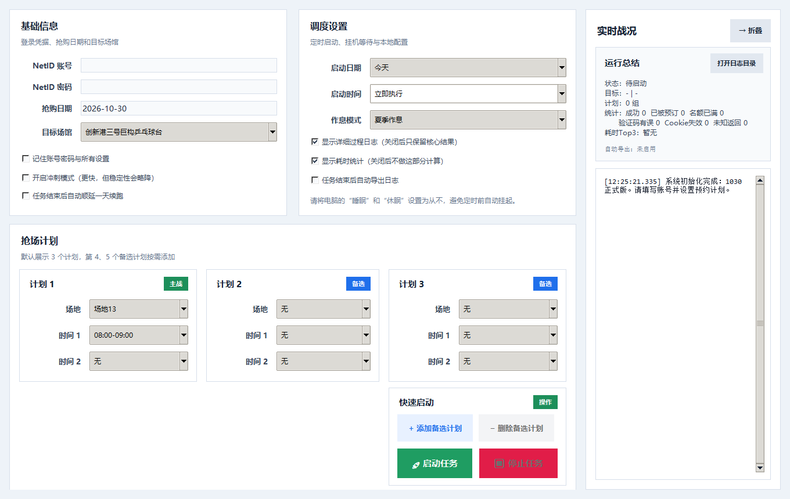
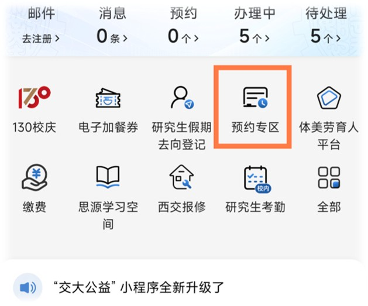
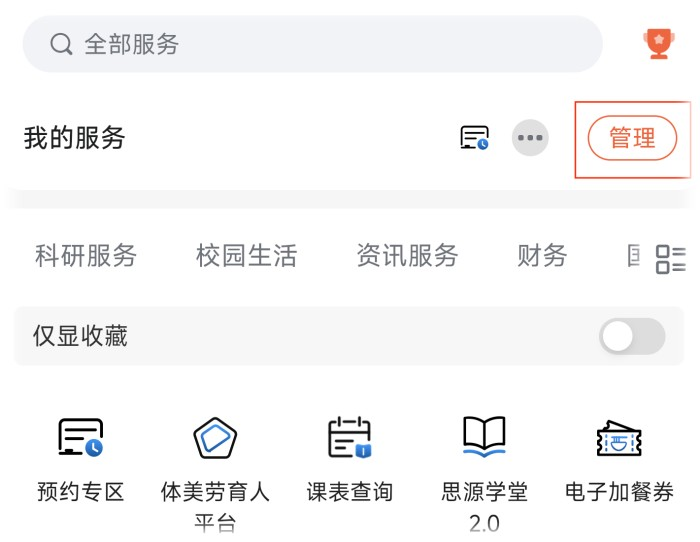

# 抢场无忧 · XJTU SPORT

西安交通大学体育场馆预约桌面辅助工具，集中管理账号、场馆、日期、执行时间和多组预约计划。支持定时执行、备选计划、夏冬作息切换、运行统计、日志导出和系统托盘。



## 快速开始

### 使用 Windows 应用

如果已有 Windows 应用包，解压到可写目录后双击 `sport.exe`。应用无需安装 Python，但电脑需要安装 Microsoft Edge，并能访问学校门户和预约服务。下载仓库源码的用户请按下一节操作。

**选择“立即执行”后会正式提交预约，请先确认场馆、日期和时段。**

### 运行 Python 源码

已在 Windows、Python 3.13 和 Microsoft Edge 环境验证。在项目目录打开 PowerShell：

```powershell
python -m venv .venv
.\.venv\Scripts\python.exe -m pip install -r requirements.txt
.\.venv\Scripts\python.exe sport.py
```

`logo.ico` 为窗口及托盘图标，请与源码一起保留。配置文件会在保存设置时自动生成。

## 使用前准备

- 先确认本人账号能正常登录学校门户，并能使用体育场馆预约服务。
- 确保门户中能找到“预约专区”或“体育场馆预约”。如果首页没有，可在门户的“服务”中进入“管理”，添加“预约专区”。
- 使用定时任务时保持电脑开机、联网，并关闭会影响任务的自动睡眠、休眠。
- 放号时间、可预约日期和预约限制以学校平台实际提示为准。


## 操作步骤

1. 在“基础信息”填写本人的 **NetID 账号和密码**。
2. 填写“抢购日期”，格式为 `YYYY-MM-DD`，再选择目标场馆。切换场馆后，场地及可选时段会联动更新。
3. 在“调度设置”选择启动日期、启动时间和夏季／冬季作息。
4. 设置计划 1，再按需要填写备选计划。至少需要一组有效的场地和时间。
5. 确认信息后点击“启动任务”，主窗口会自动收至系统托盘。立即执行模式随后启动浏览器；定时模式通常在设定时刻前约 20 秒启动浏览器并预热登录。
6. 如果校园登录出现验证码、短信或二次验证，请在浏览器中手动完成。程序最多等待 120 秒。
7. 通过托盘恢复窗口，查看右侧“实时战况”；需要结束任务时点击“停止任务”，等待当前步骤退出。

最终预约结果请以平台的订单或预约记录为准。需要排查问题时，可开启详细日志及自动导出。

## 日期与定时执行

| 设置 | 含义 | 示例 |
| --- | --- | --- |
| 抢购日期 | 实际使用场地的日期 | `YYYY-MM-DD` |
| 启动日期 | 程序在哪一天执行，按电脑当前日期计算 | 今天／明天／后天 |
| 启动时间 | 程序何时进入预约流程 | 立即执行／`08:40:00` |
| 作息模式 | 使用哪一套下午时段选项 | 夏季作息／冬季作息 |

定时时间支持 `HH:MM` 或 `HH:MM:SS`。程序通常提前约 20 秒启动浏览器，进行登录预热，再等待设置的执行时刻。

请在启动前核对时间：选择“今天”且指定时刻已经过去，会直接开始；时间格式错误时，当前实现也会提示后改为立即执行。

## 预约计划如何执行

默认显示 3 个计划：计划 1 为主计划，计划 2、3 为备选。点击“+ 添加备选计划”可展开计划 4、5；点击“− 删除备选计划”可收起最后一个额外计划。

每个计划包含“场地”“时间 1”“时间 2”。只预约一个时段时，将“时间 2”保留为“无”；不使用的备选计划也保持“无”。将最想要的场地和时间放在前面。

程序按计划顺序尝试，并根据服务端返回决定重试、切换计划或结束：

- 一个双时段计划成功后，本轮结束。
- 一个单时段计划成功后，程序会继续寻找后面的**单时段**备选，跳过已经成功的时间。
- 累计成功两个不同的时段后停止；没有合适的后续单时段计划，也会结束。

例如，计划 1 的单时段 A 成功后，后续单时段 B 可以继续尝试；重复的 A 和双时段备选会被跳过。

### 当前内置场馆

| 场馆 | 场地选项 |
| --- | --- |
| 创新港三号巨构乒乓球台 | 场地 13—18 |
| 创新港一号巨构羽毛球场 | 场地 1—3 |
| 创新港二号巨构羽毛球场 | 场地 1—6 |
| 创新港三号巨构羽毛球场 | 场地 1—3 |
| 高等工程教育博物馆负一楼羽毛球场 | 场地 1—3 |

如果学校调整场馆、作息或预约页面，需要相应更新程序。

## 开关说明

| 开关 | 作用 |
| --- | --- |
| 记住账号密码与所有设置 | 将账号和设置保存在本机，下次启动时自动读取，默认关闭。 |
| 开启冲刺模式 | 使用更紧凑的等待与重试参数，稳定性可能下降，日常使用可保持关闭。 |
| 任务结束后自动顺延一天续跑 | 本轮结束后将目标预约日期加一天；是否自动启动下一轮，见下方说明。 |
| 显示详细过程日志 | 打开后显示更完整的运行过程；关闭后仍保留核心结果。 |
| 显示耗时统计 | 记录并展示关键步骤耗时，便于排查性能问题。 |
| 任务结束后自动导出日志 | 任务结束时在程序目录生成独立的 `.log` 文件。 |

### 自动顺延

- **定时模式**：目标预约日期加一天，并安排在“明天”的同一启动时刻继续。
- **立即执行模式**：只顺延目标日期并保存设置，不自动启动下一轮。
- 本轮结束后按上述规则准备下一轮；手动停止或登录未完成时，不执行自动顺延。

使用自动顺延时请保持程序运行。系统重启、睡眠、断网、浏览器更新或学校页面变化都可能中断任务；程序关闭或电脑重启后，不会自动恢复执行。

## 实时战况与常见提示

右侧显示运行总结、结果统计、耗时 Top 3 和过程日志，可通过“折叠／展开”收起或恢复。

| 提示 | 含义及处理 |
| --- | --- |
| 预订成功 | 服务端返回成功，请核对平台预约记录。 |
| 已被预订 | 场地或时段已被占用，程序会按当前逻辑处理备选。 |
| 名额已满 | 服务端认为当天预约数量达到限制。 |
| 验证码有误 | 本次预约验证码处理失败，可结合后续重试结果和日志判断。 |
| Cookie 失效／登录未完成 | 登录状态不可用，查看浏览器提示；必要时重新登录。 |
| 未到开放时间 | 服务端尚未开放当前请求，不等于已预约成功。 |
| 未知返回／异常结束 | 查看完整日志，学校页面或返回格式可能已变化。 |
| 任务完成 | 本轮已经结束，不代表所有计划都成功。 |

校园登录时遇到验证提示，请在浏览器中完成；预约提交时的验证码由程序尝试处理。

## 托盘、配置与日志

点击窗口右上角关闭按钮会收至系统托盘，**不会直接退出程序**。完全退出请使用托盘菜单中的“退出程序”。如果系统托盘不可用，程序会退为最小化。

配置、日志和诊断文件保存在程序所在目录：

| 文件／目录 | 用途 |
| --- | --- |
| `config.example.json` | 配置格式示例，无需复制也能启动程序 |
| `config.json` | 本机设置；勾选记住时也包含账号和编码后的密码 |
| `抢场日志_*.log` | 开启自动导出后生成的运行总结及完整日志 |
| `login_diagnostics/` | 登录或运行异常时生成的诊断信息 |

默认不记住账号密码。即使没有勾选，启动任务时仍会保存日期、场馆和计划等设置，但账号与密码字段为空。

密码仅以 Base64 编码保存在本机，**Base64 不是加密**。请勿分享 `config.json`，不建议在公用电脑记住密码；分享日志或诊断前也应检查其中的信息。

## 常见问题

**启动后窗口怎么不见了？** 任务启动后会自动收至托盘，从系统托盘恢复窗口即可。右上角关闭同样不会完全退出。

**为什么只有三个计划？** 计划 4、5 默认隐藏，使用“+ 添加备选计划”展开。

**为什么没有详细日志或耗时？** 分别检查“显示详细过程日志”“显示耗时统计”开关。

**没有找到预约入口怎么办？** 先手动确认学校门户能够访问并显示预约服务，再按“使用前准备”将预约专区添加到门户。

**浏览器无法启动怎么办？** 确认 Microsoft Edge 能正常打开，网络可用。首次运行可能需要获取匹配的浏览器驱动；如仍失败，保留错误日志排查。

## 从源码构建

```text
XJTU_SPORT/
├─ sport.py                    # 程序入口
├─ logo.ico                    # 窗口、托盘和应用图标
├─ config.example.json         # 配置格式示例
├─ requirements.txt            # 运行依赖
├─ requirements-build.txt      # 打包依赖
├─ sport.spec                  # PyInstaller 配置
├─ build.ps1                   # Windows 打包脚本
├─ 使用说明.txt                 # 随应用分发的简要说明
├─ docs/assets/main-window.png # 界面预览
└─ tests/                      # 任务、登录、布局和安全导入测试
```

在项目目录的 PowerShell 中执行：

```powershell
.\build.ps1
```

脚本会准备本地 `.venv`，安装打包依赖，生成 `dist\sport.exe` 并复制到项目根目录。已有依赖时可使用 `.\build.ps1 -SkipInstall`。若原应用仍在运行而无法替换，新版会另存为 `sport_updated.exe` 或带时间戳的名称，不会强制关闭当前程序。

如果 PowerShell 不允许运行脚本，也可在完成上面的 Python 环境准备后，直接调用 PyInstaller；生成的应用位于 `dist\sport.exe`：

```powershell
.\.venv\Scripts\python.exe -m pip install -r requirements-build.txt
.\.venv\Scripts\python.exe -m PyInstaller --noconfirm sport.spec
```

测试命令：

```powershell
.\.venv\Scripts\python.exe -m unittest discover -s tests -v
```

测试使用模拟页面或独立的本地 Edge 页面，不会提交真实预约。本地浏览器布局测试需要可用的匹配驱动；没有缓存驱动时会跳过相应测试。

## 使用范围

本项目用于学习和个人预约辅助，请使用本人账号，遵守校园预约规则及平台要求。预约结果受网络、服务端状态和平台调整影响，不保证成功率。请妥善保管账号信息，并以学校平台的实际预约记录为准。
